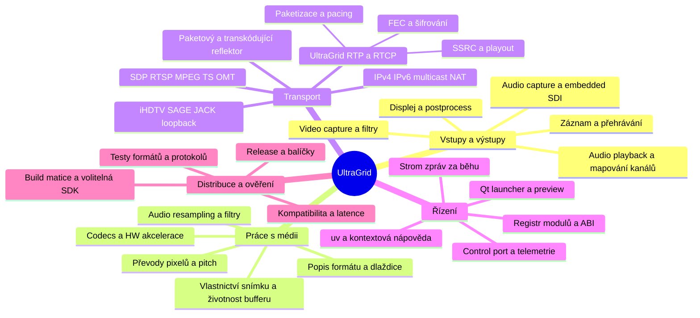

# UltraGrid před přepisem

Výchozí stav je commit [59e89f6 z 9. listopadu 2026](https://github.com/CESNET/UltraGrid/commit/59e89f6aea9285fac958481cc562f7aaf4b78f4b), společný pro tuto větev a tehdejší upstream `master`. Pro kompatibilitu se stabilním vydáním používat samostatný referenční bod [v1.10.8](https://github.com/CESNET/UltraGrid/releases/tag/v1.10.8). Transportní vrstva se mezi těmito body strukturálně změnila. U každého pozorování zapisovat verzi, OS, architekturu, konfiguraci sestavení a dostupné ovladače.

- [Inventář kódu, modulů, přepínačů a manuálů](inventory.md)
- [Zdroje a jejich použitelnost](sources.md)
- [Smlouvy mezi komponentami a ověřovací scénáře](contracts.md)

## Myšlenková mapa

## Jak sledovat tok v kódu

| Oblast | Vstupní body | Co sledovat |
| --- | --- | --- |
| Spuštění a ukončení | [main.cpp](../../src/main.cpp), [host.cpp](../../src/host.cpp) | CLI a výchozí hodnoty, inicializace displeje před moduly využívajícími grafický kontext, role odesílatele/příjemce, koordinace signálů a ukončení vláken. |
| Moduly a build | [lib_common.cpp](../../src/lib_common.cpp), [configure.ac](../../configure.ac), [Makefile.in](../../Makefile.in) | Název, třída a verze ABI, detekce knihoven a SDK, statická registrace a dynamické načítání. Registr implementací je oddělený od stromu instancí v [module.c](../../src/module.c). |
| Video TX | [main.cpp](../../src/main.cpp), [video_capture.c](../../src/video_capture.c), [capture_filter.c](../../src/capture_filter.c), [video_compress.cpp](../../src/video_compress.cpp), [rxtx.cpp](../../src/rxtx.cpp) | Grab a embedded audio, filtry, vlastnictví snímků, asynchronní komprese a vyzvednutí výstupu, export a předání vybranému transportu. |
| Video RX | [ultragrid_rtp.c](../../src/rxtx/ultragrid_rtp.c), [rtp_common.c](../../src/rxtx/rtp_common.c), [pbuf.c](../../src/rtp/pbuf.c), [video_decoders.cpp](../../src/rtp/video_decoders.cpp), [video_display.c](../../src/video_display.c) | Účastníci podle SSRC, shlukování podle RTP času, obnova a dekódování, vyjednání formátu výstupu, handoff framebufferu a display drop policy. |
| Popis videa | [types.h](../../src/types.h), [video_frame.c](../../src/video_frame.c), [video_codec.c](../../src/video_codec.c), [pixfmt_conv.c](../../src/pixfmt_conv.c) | Formát, prokládání, fps, dlaždice, FourCC, velikost a pitch řádků, zarovnání, konverze barev a HW povrchy. |
| Audio | [audio.cpp](../../src/audio/audio.cpp), [types.cpp](../../src/audio/types.cpp), [postprocess.c](../../src/audio/postprocess.c) | TX filtruje, mění počet kanálů a podle potřeby převzorkuje před kódováním. RX vyjedná výstupní PCM formát, dekóduje, zpracuje kanály a aplikuje hlasitost. Audio a video mají vlastní vlákna a transportní nastavení. |
| Síť | [rxtx](../../src/rxtx), [transmit.c](../../src/transmit.c), [rtp.c](../../src/rtp/rtp.c), [net_udp.c](../../src/rtp/net_udp.c), [nat-helper](../../nat-helper) | Transporty zvlášť pro média, nativní a standardní RTP payloady, RTCP, MTU/pacing/GSO, IPv4/IPv6, multicast a průchod NAT. SRT podle wiki přes externí zapouzdření. |
| Odolnost a šifrování | [fec.cpp](../../src/rtp/fec.cpp), [ldgm](../../ldgm), [rs.cpp](../../src/rtp/rs.cpp), [crypto](../../src/crypto) | Multiplikace paketů oproti blokové FEC, formát FEC metadat, chování s poškozeným rámcem, overhead a volba šifry. |
| Řízení a GUI | [control_socket.c](../../src/control_socket.c), [messaging.cpp](../../src/messaging.cpp), [keyboard_control.cpp](../../src/keyboard_control.cpp), [gui/QT](../../gui/QT) | Příkazy a odpovědi, fronty adresované instancím, asynchronní události/statistiky, discovery přes capabilities, spouštění `uv` z Qt. |
| Nahrávání a pomocné programy | [export.c](../../src/export.c), [video_export.c](../../src/video_export.c), [playback.c](../../src/playback.c), [hd-rum-multi](../../hd-rum-multi), [hd-rum-translator](../../src/hd-rum-translator), [tools](../../tools) | Záznam A/V a metadata, přehrávání, UDP fan-out a dynamické výstupy reflektoru, decode/recompress a IPC nástroje. |
| Dodávka a testy | [test](../../test), [.github/workflows](../../.github/workflows), [package_specs](../../package_specs), [ext-deps](../../ext-deps) | Konverzní, síťové a integrační testy, platformní rozdíly, balíčky, externí knihovny a runtime dostupnost SDK. |

## Stav pokrytí

Hlavní toky byly ověřeny statickým čtením, inventář vychází ze sledovaných souborů, registrací a konfiguračních voleb. Každý ovladač a kodek má v inventáři vstupní bod, detailní chování jednotlivých variant čeká na kontrolu. Pro definitivní specifikaci doplnit výstupy skutečných sestavení, výsledky interoperabilních testů, packet capture a ověření zařízení. Wiki slouží také jako historický archiv a datum její aktualizace neurčuje dostupnost funkce v konkrétním buildu.
